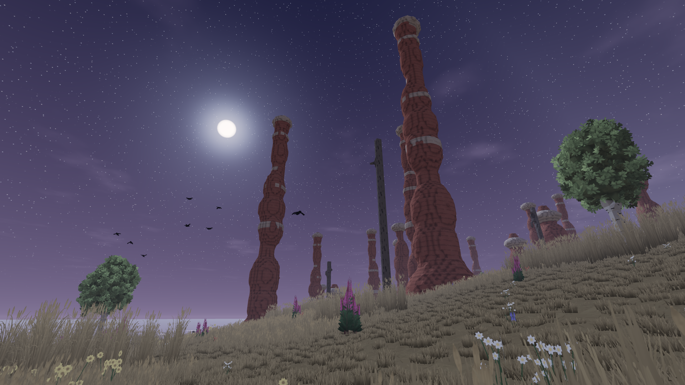
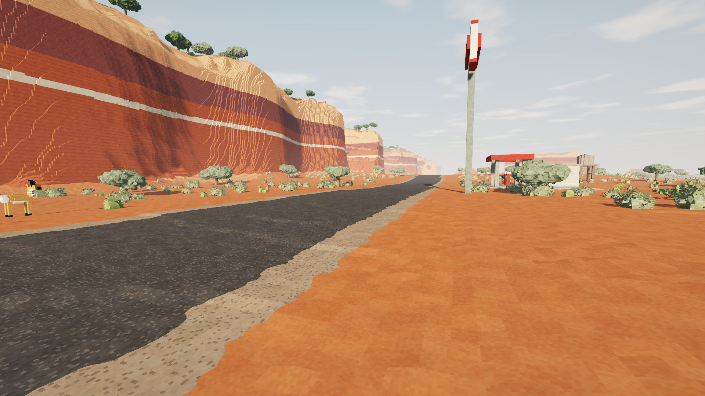
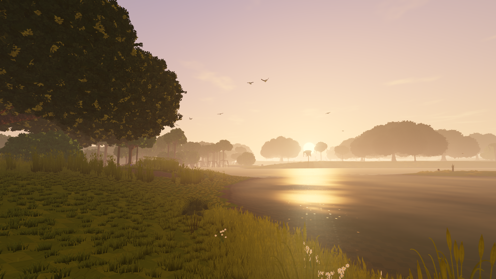
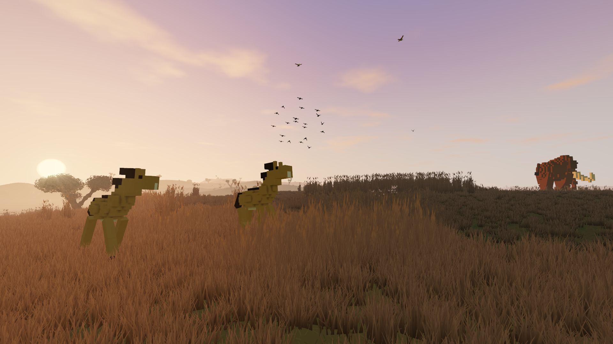
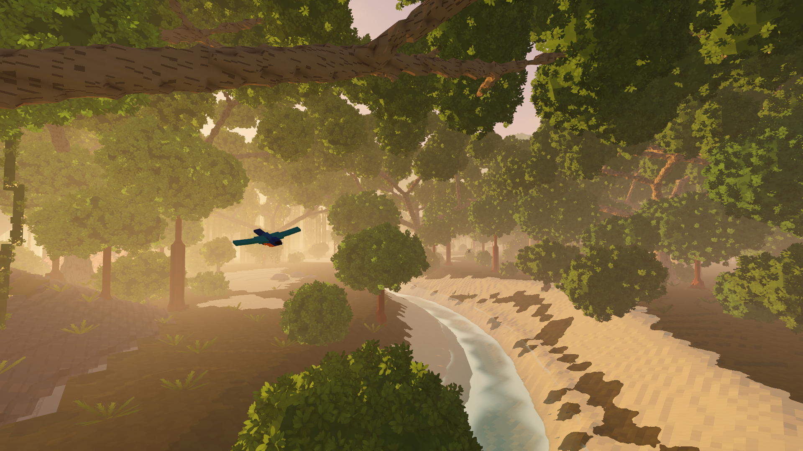

# Lurelia

Lurelia is an open-world voxel-based wilderness sandbox and arena shooter built on a custom
Rust and wgpu voxel engine.



Lurelia is an engine that allows you to play different games in different worlds. Currently it supports:

- A peaceful open-world exploration game where you hike, mountain bike,
  wingsuit, kayak, free-climb and scuba dive across landscapes shaped by
  simulated geological history. You'll share terrain as varied as paleolithic grasslands, tropical karst towers, nordic fjords, faerie forests and an upland where dinosaurs never died out, with 209 species of wildlife, 166 species of plants, and dozens of procedural structures, artifacts, towns, trails and roads.
- A fast retro arena deathmatch where triple jumps, double dodges,   terrain-carving, trap-laying, enemy-decimating weapons that change each map, each time you play it. No multiplayer, but supports smart local bots.
- Kart racing on hand-built circuits: drift boosts, pickup rows of weapons,
  shields and boosts, a racing line that polishes in as karts wear it, and
  bots bred in tournaments.

## Part I: the open world

Open-world mode is built around curiosity and a sense of place. There are no
quest markers, no health bars and no enemies in the wild. Every island, desert
canyon, fjord and bayou is generated from a written chronicle of its history:
sixty-three kinds of geological and human events, run in order before you take
your first step.

Volcanoes pour lava tongues down to the sea and blanket the leeward hills in
ash. Rivers carve benched gorges through those buried strata and drop in misty
waterfalls over cliff scarps. Glaciers grind deep U-shaped valleys, coral atolls
ring lagoons with white-sand motus, and villages grow along A\*-routed streets
and suspension bridges before they are left to age, weather and collapse when
their people move on. Exploring a world means walking through the aftermath of
its history: discovering named places, reading local signposts, and picking up
arrowheads, coins and skystone shards left behind in the dirt.



### Seven ways to travel

You can cross every kilometre of land, cliff and sea with movement modes that
flow into one another:

- On foot and free climbing. Walk, sprint and crouch through the brush, or walk
  up to any rock face or large trunk to start climbing: follow rounded stone
  bulges, lean out under overhangs, and pull yourself over the rim at the top.
- Mountain bike. Drop onto dirt trails and open downs, lean into grip-limited
  turns, pre-load the suspension to pop off crests, and tuck down steep grades
  to charge boosted jumps through seeded trails of speed rings.
- Wingsuit and glider. Spring into the air from a standstill or pitch off a
  peak and glide at up to 175 km/h. Ride thermals and windward ridge lift, or
  dive into narrow canyons, where hugging the walls, skimming the deck and
  threading stone arches build a proximity flight score.
- Grapple rope. Throw a 48 m line onto high rock or timber to swing across
  chasms, rappel into volcanic skylights, or let go at the top of a swing and
  open the wingsuit.
- Kayak. Launch from the shore to paddle across glassy lakes and down river
  rapids, running aground on shallow gravel bars or out into deep water.
- Scuba diving. Under the surface, sunlight filters through Snell's window and
  caustics move on the seabed. Swim with reef sharks and schools of tropical
  fish, ride deep currents, or hold on to a passing humpback, manta ray or sea
  turtle for a tow.
- Driving. Call up an ATV, a beach buggy or a sand rail wherever a world
  allows it, and take it over dunes, voxel steps and dirt roads on long soft
  suspension, hopping and drifting as a kart does.

### 209 creatures and 166 plants

All of the life is procedural. The library holds 166 plant species across
twenty-eight growth forms, from tall conifers, weeping willows and hollow
walk-in baobabs to kelp beds and antler coral, and 209 animal species, sauropods and tyrannosaurs among them, animated
in real time by bone motors rather than recorded clips.

Wildlife fills the air, land and water with behaviour of its own:

- Flocks, herds and schools. Starlings wheel in boid flocks, geese fly in V
  formations, deer and bison graze in herds with juveniles at their side, and
  bait balls of 150 fish pulse and scatter when a barracuda or reef shark rushes
  them.
- Predation and life cycles. Every species spawns in four ages: juvenile,
  adult, aged, and a skeleton generated from the animal's own voxels. Wolves,
  big cats and bears hunt, then carry or drag the carcass away.
- Wariness. Each creature tracks your approach and builds up alarm from your
  distance, your speed, whether you are facing it and how noisy your way of
  travelling is. Charging in on a bike or swooping low in a wingsuit scatters a
  herd; creeping up in a crouch behind cover gets you close.
- Wildlife photography. The camera's viewfinder has zoom, focus and aperture
  with real depth of field. A logbook sets photography tasks that check whether
  the subject is sharp, well framed and caught in the right light or behaviour,
  and completed shots go into the world's scrapbook with a ribbon.



### Skies, weather and seasons

Time runs on a 25-minute day paced by the sun's elevation, which stretches out
golden hour and twilight. Weather drifts between clear skies, heat shimmer,
cloud, rain, fog and snow, with cloud shadows crossing the hills and mist
pooling in the valleys at dawn.

Most worlds turn through the seasons. In autumn the deciduous woods change
colour tree by tree until the hills are orange and gold, then drop their
leaves and go bare for winter. Snow lies at three depths across meadows and
rooftops, insects vanish until spring, and animals shift their daily routines
to the cold and the dark.



## Part II: the arena shooter

Launched in DEATHMATCH mode, a world becomes a vertical arena shooter in the
style of the late-90s classics, with the difference that the whole arena is
made of live, destructible voxels.

- Arena movement. You run at full sprint by default, carry a regenerating
  boost bar, chain up to three jumps in the air, and tap out directional
  dodges and dodge-jumps to cross between platforms, portals and jump pads.
- Destructible voxels. The ten weapons do more than trade hit points. The Bore
  fires a continuous rock-drilling beam that cuts new tunnels and sightlines
  through arena walls, and its alt fire throws the spoil. The Digger blasts
  away close cover, the Goo Gun coats floors and walls in damaging sludge
  voxels, the Skipjack bounces razor discs round corners, and the Rocket
  Launcher blows craters in the floor and powers rocket jumps.
- Maps that mend, bots that don't cheat. At the end of every match the arena
  regenerates every destroyed voxel, so the next one starts clean. The bots
  fill in the same movement input struct your keyboard does, so they dodge,
  air-jump, use jump pads and lead their targets across seven difficulty
  levels without bending physics or seeing through walls.
- Teams and capture the flag. TEAM DEATHMATCH plays any arena as two sides.
  CAPTURE THE FLAG adds a flag at each base: take theirs off its stand and
  carry it home with your own still there. A team brain over each side hands
  its bots jobs (attack by a lane, carry, escort, defend a post, chase the
  thief, return a dropped flag) and knows no more than the side could see.

## The worlds

Lurelia ships with twelve open-world landscapes, three kart circuits and
eight arenas, and
can also load random islands and worlds you keep locally:

- Glassfall: a volcanic island with a meteor crater, a strewn field of black
  glass where strange flora grows, wrecks on a coral reef, and an abandoned
  village.
- Redrock: stepped red-rock mesas, a deep canyon crossed by a highway arch
  bridge, a ghost town, a drying reservoir and a bermed dirt-bike track.
- Jadewater: flooded limestone towers rising from a green lagoon, narrow
  sun-sliced gorges, suspension bridges, a moving ferry and a deep cenote reef.
- Hemlow: a Cotswold village with working doors, a waterfall plunging off a
  scarp into a glow-worm cave, and a faerie wood round a stone circle.
- Lowmouth: a sinking bayou delta of stilt houses, cypress swamps, murky water,
  a drowned parish, and things that stand at the crossroads only at night.
- Kaldvik: a winter fjord at 64 degrees north, cut by glaciers, with sea ice,
  steaming vents, diamond dust in the air and the aurora most nights.
- Windbarrow: Neolithic chalk downs under golden grass, barrows, a hilltop
  temple, cave bears, and sky rays undulating on the wind.
- Thornpan: an inland delta fanning out over white salt pans, with hollow
  walk-in baobabs, granite kopjes and shipwrecks far from any sea.
- Ribshore: a grey northern coast of wet sand and grassy dunes, with the
  skeleton of a giant sea hunter lying along the beach.
- Saltmirror: a salt pan flat enough to mirror the sky, eleven abandoned radio
  dishes still facing the zenith, and something burned up in the range behind
  them.
- Gannet Harbor: a whaling town on a grey bay, swept and rigged for sea with
  nobody in it, walled sheep pasture, a river out of the redwoods and two
  granite islands in the mouth of the bay.
- Saurischia: the upland east of Hemlow where the great animals never died
  out, with sauropod herds, horned skulls and trackways, a lava field and
  the villages of the people who stayed to live beside them.
- Peregrine Ridge, Vermilion Mesa and Ribstrand: the kart circuits. A fast
  loop over chalk downs, a figure-eight up a red rock mesa and back through
  a tunnel under its own road, and a lap of a grey beach and its dunes that
  ends down the middle of a titan's ribcage.
- Porch, Transmission, Slagdeck and Duelbox: the arenas. A frozen outpost of
  rooms and a long porch, a three-storey relay station inside a glacier, an
  offshore smelter over molten slag, and a plain box for testing weapons.
- Sluice, Megalith, Starfall and Ctfbox: capture the flag. Two pump yards
  across a drained spillway with three ways between them, a chalk canyon and
  caves under open steppe, two towers on a rock in open space with low gravity
  between them, and a plain room for testing the team brain.



## Engine and live editors

On an RTX 3060 at 1440p with 4x MSAA a frame takes 2.3 to 5 ms, thanks to GPU
depth-pyramid occlusion culling, leaf crowns meshed in larger blocks, draw
lists bucketed near to far, and shadow cascades updated in slices.

Content is data: 473 materials, 332 structures, 209 creatures, 200 biomes and
166 plants, each a short JSON file in `library/`. Two studios built into the
game let you change it while it runs: one grades the sky, fog and colour ramps
live, and a turntable studio edits creatures, plants, materials and weapons and
writes the change straight back to disk. The engine also runs headless from
the command line to take screenshots, draw top-down world maps, run bot
tournaments and run its 720 unit and shader tests.

## Installation

Install Rust with [rustup](https://rustup.rs/). On Windows, use the GNU
toolchain (or MSVC if you have the Visual Studio C++ build tools) and run with
`--locked`:

```bash
rustup default stable-x86_64-pc-windows-gnu
cargo run --release --locked
```

Keep `--locked` and don't run `cargo update`: three crates in `Cargo.lock` are
held one patch release back so the GNU toolchain builds without an external
assembler. The first build takes about a minute and opens on the title screen.

[GUIDE.md](GUIDE.md) has the full controls and command-line flags,
[ARCHITECTURE.md](ARCHITECTURE.md) the code structure, and
[docs/PERFORMANCE.md](docs/PERFORMANCE.md) the rendering pipeline.

## License

Dual-licensed under [MIT](LICENSE-MIT) and [Apache 2.0](LICENSE-APACHE), at
your option. The two bundled fonts, Cinzel and Cormorant Garamond, are under
the SIL Open Font License 1.1, whose text ships beside them in
[library/fonts/](library/fonts/).
